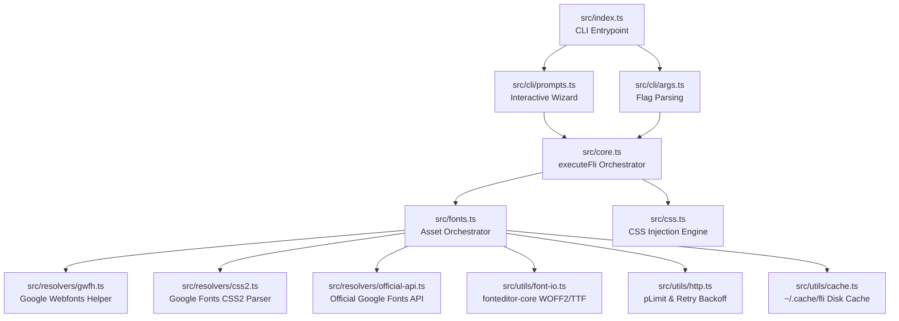

# `@dstn/fli` Technical Documentation

Technical documentation for `@dstn/fli` (v2.0.0): module layout, how font metadata is resolved, atomic file writes, the programmatic API and troubleshooting.

---

## Table of Contents
1. [Architecture Overview](#1-architecture-overview)
2. [Hybrid Font Resolution Chain](#2-hybrid-font-resolution-chain)
3. [Format Derivation Engine](#3-format-derivation-engine)
4. [Atomic I/O & Rollback Guarantee](#4-atomic-io--rollback-guarantee)
5. [Programmatic API Reference (`executeFli`)](#5-programmatic-api-reference-executefli)
6. [Troubleshooting & FAQ](#6-troubleshooting--faq)

---

## 1. Architecture Overview

Each module in `@dstn/fli` has one job (Single Responsibility Principle). The core logic does not depend on the interactive prompts or on process lifecycle handling.



### Module Directory Breakdown

- `src/cli/`: the `@clack/prompts` wizard and the argument parser (`node:util parseArgs`).
- `src/core.ts`: the orchestration layer (`executeFli`). It creates the backup and rolls back on errors.
- `src/resolvers/`: interchangeable font metadata resolvers.
- `src/utils/`: network retries, concurrency limiting, disk caching, font magic-byte checks and CSS inspection.

---

## 2. Hybrid Font Resolution Chain

So that a single unreachable API does not break a build, `fli` tries three sources for font metadata:

```
           ┌──────────────────────────────────────────────┐
           │     1. Google Webfonts Helper (gwfh)         │
           └──────────────────────┬───────────────────────┘
                                  │ (on failure)
                                  ▼
           ┌──────────────────────────────────────────────┐
           │     2. Google Fonts CSS2 Parser              │
           └──────────────────────┬───────────────────────┘
                                  │ (on failure & API key set)
                                  ▼
           ┌──────────────────────────────────────────────┐
           │     3. Official Google Fonts Webfonts API v1 │
           └──────────────────────────────────────────────┘
```

1. Google Webfonts Helper (`gwfh.mranftl.com`) returns direct binary URLs for all formats (`woff2`, `woff`, `ttf`, `eot`, `svg`) with weight and style metadata. Responses are cached in `~/.cache/fli/` for 24 hours.
2. Google Fonts CSS2 Parser (`fonts.googleapis.com/css2`): if the helper API is unreachable, `fli` requests Google's official CSS2 endpoint with a modern User-Agent and parses the URLs in the `@font-face` declarations.
3. Official Google Fonts Webfonts API v1: if `GOOGLE_FONTS_API_KEY` is set in the environment, `fli` queries the official v1 API as the last option.

---

## 3. Format Derivation Engine

If the resolver does not offer a requested format (such as legacy `woff`, `eot`, or `svg`), `fli` downloads the TrueType (`ttf`) font and converts it locally with `fonteditor-core`.

### Magic Byte Validation
Before converting or saving font files, `fli` checks their headers:
- TrueType (`TTF`) files must start with `0x00010000` or `OTTO` (`0x4f54544f`).
- WOFF2 files must start with `wOF2` (`0x774f4632`).

---

## 4. Atomic I/O & Rollback Guarantee

An automated run never leaves your repository with corrupted files or half-injected CSS.

### TOCTOU Prevention
When `fli` creates a target CSS file (`ensureCssFile`), it opens it with the exclusive flag (`flag: 'wx'`), so concurrent processes cannot race between the existence check and the write (Time-of-Check to Time-of-Use).

### Atomic File Writes
Font files and stylesheets go to temporary files (`.tmp`) in the destination folder first. Once the write has completed, `fs.promises.rename` replaces the target file in one step.

### Automatic Rollback
Before it changes your stylesheet, `executeFli` saves a copy (`.fli-backup`). If a font download fails or the `@font-face` injection throws, the original stylesheet is restored.

---

## 5. Programmatic API Reference (`executeFli`)

Node.js code and build scripts can call `fli` directly, without prompts:

```typescript
import { executeFli, type FliOptions, type FliResult } from '@dstn/fli/core';

const options: FliOptions = {
  fonts: ['Inter', 'Roboto'],
  formats: ['woff2'],
  weights: [400, 700],
  frameworkKey: 'next',
  cssPath: '/path/to/project/src/app/globals.css',
  projectRoot: '/path/to/project',
  dryRun: false,
  verbose: true,
};

const result: FliResult = await executeFli(options);
console.log(`Saved ${result.filesWritten} files to ${result.outputDir}`);
```

### `FliResult` Schema
```typescript
interface FliResult {
  filesWritten: number;        // Number of font binaries written to disk
  outputDir: string;           // Absolute path to destination static folder
  injectedFamilies: string[];  // Families injected into CSS
  skippedFamilies: string[];   // Families skipped (already present in CSS)
  publicUrlBase: string;       // Public URL prefix used in CSS src URLs
}
```

---

## 6. Troubleshooting & FAQ

### Q: I am receiving `HTTP 429` rate limit errors during heavy builds.
On `HTTP 429`, `fli` reads the `Retry-After` header and retries up to 3 times with exponential backoff. If the limit keeps hitting, let parallel builds share the cache directory (`~/.cache/fli/`).

### Q: How do I clear the local metadata cache?
Call `clearCache()`:
```typescript
import { clearCache } from '@dstn/fli';
await clearCache();
```

### Q: How do I specify a custom asset path for Vanilla projects?
Pass `--framework vanilla --css <path-to-css>`. `fli` stores the files under `public/fonts` and references them as `/fonts/<filename>`.

---

## 7. CI/CD & NPM Automatic Publishing

There are two GitHub Actions workflows in `.github/workflows/`:

1. `ci.yml` (Continuous Integration)
   - Runs on every push to `master` and on pull requests against it.
   - Runs the TypeScript type check (`npm run typecheck`), the production build (`npm run build`) and the Vitest suite (`npm test`).

2. `release.yml` (GitHub Release and npm publishing)
   - Starts via `workflow_dispatch` or when a git tag is pushed (`v*`, `*.*.*`).
   - Installs and tests from scratch (`npm ci && npm test`).
   - Takes the latest version section from `CHANGELOG.md` and creates a GitHub Release with the `gh` CLI.
   - Publishes `@dstn/fli` to the public npm registry with a provenance attestation (`npm publish --provenance --access public`) through npm Trusted Publishing (OIDC, `id-token: write`), so no static token or secret is needed.

